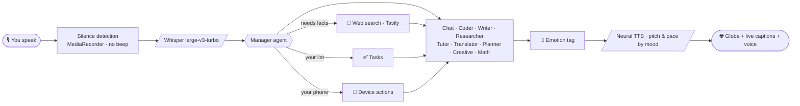

<div align="center">

# 🌐 SADIA&nbsp;AI

### *তোমার কণ্ঠের সঙ্গী — a voice-first AI companion that speaks Bangla like a friend.*


**Speak. She listens, thinks, searches, feels — and answers in a voice that sounds like a person.**

</div>

---

## ✨ What makes Sadia different

| | |
|---|---|
| 🎙 **Voice only** | No chat box. Just talk. Her words appear as live closed captions and vanish with her voice. |
| 🌐 **A living dotted globe** | A slow-turning globe of ~5,000 tiny dots in rose-gold and amethyst. It listens, thinks, and pulses with her voice. |
| 🧠 **Nine specialist agents** | A Manager reads your request and routes it to the right mind: Chat, Coder, Writer, Researcher, Tutor, Translator, Planner, Creative, Math. |
| 💬 **Real emotions** | Every reply carries a mood. Her **voice pitch and pace**, the **globe's colours**, and her **word choice** change with it: joy, sadness, worry, shyness, laughter, anger. |
| 🎭 **Any character, on command** | *"সিগমা হয়ে কথা বলো"* or *"মিষ্টি করে কথা বলো"*. The tone **and** the voice adapt. *"আগের মতো কথা বলো"* resets her. |
| 🇧🇩 **Desi at heart** | Warm, everyday Bangladeshi Bangla, not textbook Bangla. |
| 🔎 **Real, current answers** | Live web search before she answers news, prices, weather and scores. If she can't find it, she says so instead of guessing. |
| 👁 **She can see** | Turn on the camera and ask what she sees. |
| ✅ **Tasks that remember** | *"টাস্কে যোগ করো দুধ কেনা"*, with optional reminders. |
| 🗣 **Female & male voice** | Natural neural voices in six languages. |
| 📱 **Device actions** | Alarms, reminders, calls and more through a native Android plugin. |
| 🔄 **Updates itself** | The app checks `version.json` and offers a one-tap update. |

---

## 🗣 Languages

বাংলা · English · हिन्दी · اردو · العربية · Melayu

Tap the language button on the dock, pick from the list, or just say *"ইংরেজিতে কথা বলো"*.

---

## 🧭 How it works



Everything heavy runs in **Cloudflare Workers**; the app is a light front end. API keys never touch the app.

---

## 🗂 Project structure

```
├── index.html        UI shell: globe, dock, settings, tasks
├── version.json      current app version (drives the update button)
├── worker.js         Cloudflare Worker: /chat  /search  /tts  /stt
└── js/
    ├── app.js        brain: agents, voice, languages, tasks, emotions
    ├── avatar.js     the dotted 3D globe
    ├── bd.js         Bangladesh knowledge
    └── about.js      the owner's profile for personalised answers
```

---

## 🚀 Setup

### 1 · Deploy the Worker
1. Create a Cloudflare Worker and paste in **`worker.js`**.
2. Add these **Secrets** (Settings → Variables and Secrets):

| Secret | Used for |
|---|---|
| `GROQ_KEY` | chat models, Whisper speech-to-text, vision |
| `OPENROUTER_KEY` | coding / writing models (falls back to Groq automatically) |
| `TAVILY_KEY` | live web search (without it, a weaker fallback search is used) |

3. Deploy, then put your Worker URL into the app's `W` constant in `js/app.js`.

### 2 · Host the app
Upload the files above to GitHub (Pages works well). Bump `version.json` **and** `APP_VERSION` in `js/app.js` together on every release so users see the update button.

### 3 · Scale beyond one Worker
Open **Settings → extra Worker URLs** and add more (one per line). Sadia spreads requests across them, and quietly skips any that hit a limit for a minute.

---

## 🎛 Say it, don't type it

| Say | Sadia does |
|---|---|
| *আজকের আবহাওয়া কেমন?* | searches the web, answers with fresh facts |
| *ইংরেজিতে কথা বলো* | switches language |
| *সিগমা হয়ে কথা বলো* | adopts the character: deeper, slower, confident |
| *মিষ্টি করে কথা বলো* | softer, warmer voice and wording |
| *আগের মতো কথা বলো* | back to normal Sadia |
| *টাস্কে যোগ করো …* | adds a task (add *"১০ মিনিট পর মনে করাও"* for a reminder) |
| *আমার টাস্কগুলো কী কী?* | reads your list |
| *আমি কী পরে আছি?* (camera on) | looks and tells you |

---

## 🔐 Privacy & safety

- API keys live **only** in Worker secrets, never in the app or the repo.
- Keep personal details out of any public repo, including `js/about.js`.
- For sensitive actions (sending messages, deleting, money), Sadia should confirm out loud first.

---

## 🗺 Roadmap

- [ ] Photoreal **3D avatar** (VRM) with lip-sync and facial emotions
- [ ] Always-on **background listening** through a native foreground service
- [ ] In-app **APK updater** for native changes
- [ ] More voices and regional Bangla flavours

---

<div align="center">

**Built with ❤ in Bangladesh · by Al-Amin**

*Sadia AI is distributed as a standalone Android app (APK).*

© Sadia AI. All rights reserved.

</div>
